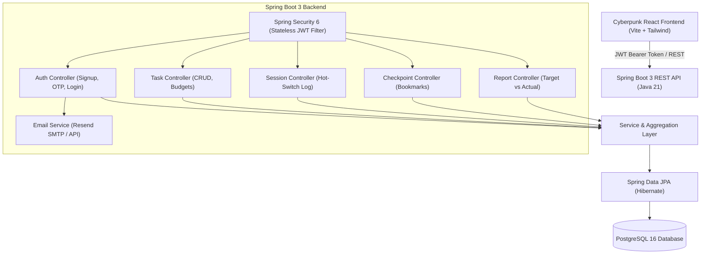
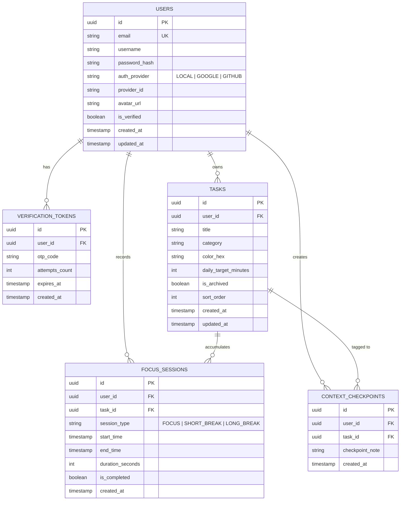
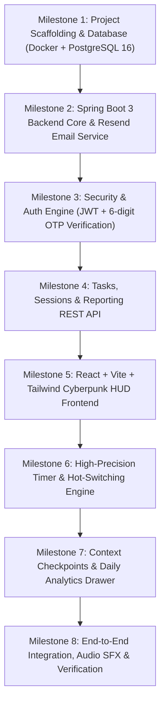

# Implementation Plan: Pomofocus Pro (v1 - Cyberpunk HUD Edition)

**Project Location:** `/home/shreyash/projects/pomofocus-pro` (`\\wsl$\Ubuntu\home\shreyash\projects\pomofocus-pro`)  
**Target Platform:** Web Application (React + Vite + TypeScript) + REST API (Java 21 + Spring Boot 3 + PostgreSQL 16)  
**Email Verification Service:** Resend API / SMTP  

---

## 1. Executive Summary & Core Value Proposition

Standard Pomodoro timers fail when users manage multiple competing responsibilities (e.g., DSA practice, system design study, project development). Switching between tasks mid-day causes lost tracking, broken mental state, and zero visibility into whether daily time targets were achieved.

**Pomofocus Pro v1** solves this with three core superpowers:
1. **Daily Target Time Budgets:** Allocate target hours and minutes per task (e.g. 2h DSA, 3h Project, 1h System Design).
2. **One-Click Hot Switching (`1–9` keys):** Switch active tasks instantaneously mid-session without stopping the clock or losing accumulated seconds.
3. **Context Checkpoints ("Where I Left Off"):** When switching away from a task, quickly save a 1-line bookmark note (e.g., *"Solved tree traversal; next implement AVL rebalancing"*), which automatically re-appears when you resume the task.
4. **Persistent Target Analytics & Reports:** PostgreSQL-backed daily/weekly reports tracking Target vs. Actual time, Deficit/Surplus alerts, and session timelines.
5. **Two-Step Email Verification Auth (Resend):** Secure registration with 6-digit OTP delivery, extensible to Google/GitHub OAuth2.

---

## 2. System Architecture



---

## 3. Database Schema (PostgreSQL 16)



---

## 4. REST API Specification

### 4.1 Authentication (`/api/v1/auth`)
- `POST /api/v1/auth/signup`
  - Body: `{ "email": "user@example.com", "username": "shreyash", "password": "securePassword123" }`
  - Response: `{ "status": "PENDING_VERIFICATION", "message": "Verification code dispatched via Resend" }`
- `POST /api/v1/auth/verify-email`
  - Body: `{ "email": "user@example.com", "otp": "742918" }`
  - Response: `{ "token": "eyJhbGciOi...", "user": { "id": "...", "email": "...", "username": "..." } }`
- `POST /api/v1/auth/resend-code`
  - Body: `{ "email": "user@example.com" }`
  - Response: `{ "message": "Fresh code sent. Please check your inbox." }`
- `POST /api/v1/auth/login`
  - Body: `{ "email": "user@example.com", "password": "securePassword123" }`
  - Response: `{ "token": "eyJhbGciOi...", "user": { ... } }`
- `GET /api/v1/auth/me`
  - Headers: `Authorization: Bearer <token>`
  - Response: Current user profile

### 4.2 Tasks & Daily Budgets (`/api/v1/tasks`)
- `GET /api/v1/tasks`: List all active tasks for user (with today's realized seconds).
- `POST /api/v1/tasks`: Create task with title, category, color, and `dailyTargetMinutes`.
- `PUT /api/v1/tasks/{id}`: Update task details or daily target budget.
- `DELETE /api/v1/tasks/{id}`: Soft delete / archive task.

### 4.3 Focus Sessions & Hot-Switching (`/api/v1/sessions`)
- `POST /api/v1/sessions`: Log a completed or hot-switched focus block:
  - Body: `{ "taskId": "...", "sessionType": "FOCUS", "startTime": "...", "endTime": "...", "durationSeconds": 1420, "completed": true }`

### 4.4 Context Checkpoints ("Where I Left Off") (`/api/v1/checkpoints`)
- `POST /api/v1/checkpoints`: Save a bookmark when switching tasks or pausing:
  - Body: `{ "taskId": "...", "checkpointNote": "Completed LeetCode #146, next review LRU cache tests" }`
- `GET /api/v1/checkpoints/latest?taskId={id}`: Get the latest bookmark for this task to display when resuming.

### 4.5 Reports & Analytics (`/api/v1/reports`)
- `GET /api/v1/reports/daily?date=YYYY-MM-DD`:
  - Target vs. Actual minutes per task.
  - Overall completion percentage.
  - Deficit / Surplus indicators (`+20m` / `-45m`).
  - Context switch count & session chronological timeline.
- `GET /api/v1/reports/weekly?startDate=YYYY-MM-DD&endDate=YYYY-MM-DD`:
  - 7-day focus trend and consistency score.
- `GET /api/v1/reports/export?format=csv`:
  - Raw session data exported for spreadsheet tracking.

---

## 5. Frontend UI/UX (Cyberpunk Terminal HUD)

- **Color Palette:**
  - Obsidian Background: `#08090d`
  - Surface Glass: `rgba(18, 22, 34, 0.75)` with backdrop-blur
  - Neon Cyan (Focus): `#00f3ff`
  - Emerald Green (Break): `#10b981`
  - Electric Magenta (Accent/Deficit): `#ff007f`
  - Neon Amber (Target Warning): `#f59e0b`
- **Core Screens & Components:**
  1. **HUD Timer Center:** Large glowing digital monospace countdown (`25:00`), mode tabs (FOCUS / SHORT BREAK / LONG BREAK), play/pause/skip buttons.
  2. **Active Task HUD Card:** Current task banner, daily target dial (`[████████░░] 80% (1h 36m / 2h 00m)`), and last Context Checkpoint bookmark display.
  3. **Task Deck & Hot-Switcher:** List of user tasks with keyboard shortcut badges (`[1]`, `[2]`, `[3]`), target hours, and 1-click active selector.
  4. **Context Checkpoint Modal:** Triggered on hot-switch or `C` key: *"Switching task! Quick note on where you left off?"*.
  5. **Daily Analytics Drawer (`A` key):** Slide-out telemetry showing target vs. actual dials, switch timeline, and CSV export button.
  6. **Auth Modal (Cyberpunk styled):** Sign In, Sign Up, and 6-Digit OTP verification screen.
  7. **Web Audio SFX:** Futuristic chime on timer finish, mechanical switch click, warning tone on budget deficit.

---

## 6. Implementation Milestones



---

## 7. Secrets & Environment Configuration

### `backend/.env`:
```env
# Database
SPRING_DATASOURCE_URL=jdbc:postgresql://localhost:5432/pomopro
SPRING_DATASOURCE_USERNAME=pomouser
SPRING_DATASOURCE_PASSWORD=pomopass

# JWT Security
JWT_SECRET=404e635266556a586e3272357538782f413f4428472b4b6250645367566b5970
JWT_EXPIRATION_MS=86400000

# Resend Email Configuration
SPRING_MAIL_HOST=smtp.resend.com
SPRING_MAIL_PORT=465
SPRING_MAIL_USERNAME=resend
SPRING_MAIL_PASSWORD=your_resend_api_key_here
MAIL_FROM_ADDRESS=onboarding@resend.dev
MAIL_FROM_NAME=Pomofocus Pro
```

### `frontend/.env`:
```env
VITE_API_BASE_URL=http://localhost:8080/api/v1
```
