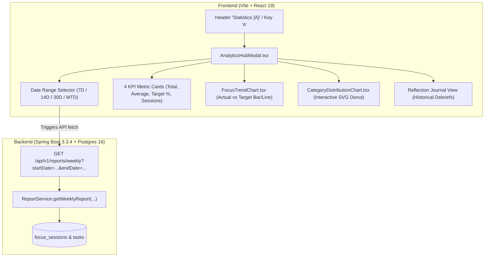

# Implementation Plan: Insights & Analytics Hub (Graphs Module)

A dedicated, full-screen **Insights & Focus Analytics Hub** for Pomofocus Pro, providing high-precision data visualizations for daily focus trends (Target vs Actual) and category/task distribution (Interactive Donut & Ranked Deck) styled in the **Tercelet Warm Editorial** aesthetic.

---

## User Review Required

> [!IMPORTANT]
> **Component Placement & Replacement:**
> The new full-featured **Insights & Analytics Hub** will replace the narrower side drawer for statistics while retaining the **Daily Reflection Journal** tab inside it. Clicking the **"Statistics [A]"** button in the top navigation or pressing key `A` will now open this full-screen analytics modal.

> [!NOTE]
> **Zero Heavy Chart Dependencies:**
> Charts will be built using lightweight, high-performance, native React SVG with Tailwind CSS. This guarantees **zero bundle bloat**, **100% theme fidelity** with Tercelet design tokens (`#3157f6`, `#c9f45b`, `#f5f3ee`), and **zero compatibility issues with React 19**.

---

## Architecture Overview



---

## Proposed Changes

Grouped by component and layer:

### 1. Backend: Enhanced Category Distribution & Flexible Ranges

Enhance `WeeklyReportResponse` and `ReportService` to calculate category-level aggregations directly and ensure unassigned focus sessions are properly tracked.

#### [MODIFY] [`backend/src/main/java/com/pomofocus/pro/dto/CategoryReportItem.java`](file:///home/shreyash/projects/pomofocus-pro/backend/src/main/java/com/pomofocus/pro/dto/CategoryReportItem.java)
- Create a clean DTO representing category distribution:
  ```java
  public class CategoryReportItem {
      private String category;
      private String colorHex;
      private int actualMinutes;
      private double percentageOfTotal;
      private int sessionCount;
  }
  ```

#### [MODIFY] [`backend/src/main/java/com/pomofocus/pro/dto/WeeklyReportResponse.java`](file:///home/shreyash/projects/pomofocus-pro/backend/src/main/java/com/pomofocus/pro/dto/WeeklyReportResponse.java)
- Add `categoryBreakdown` list to the response payload.

#### [MODIFY] [`backend/src/main/java/com/pomofocus/pro/service/ReportService.java`](file:///home/shreyash/projects/pomofocus-pro/backend/src/main/java/com/pomofocus/pro/service/ReportService.java)
- In `getWeeklyReport(LocalDate start, LocalDate end, String clientZoneId)`:
  - Aggregate focus time by `category` (mapping tasks to their categories and grouping unassigned sessions as "General / Quick Focus").
  - Compute `percentageOfTotal` for each category.
  - Return sorted by highest focus time.

---

### 2. Frontend: API Client & Store Extensions

#### [MODIFY] [`frontend/src/api/client.ts`](file:///home/shreyash/projects/pomofocus-pro/frontend/src/api/client.ts)
- Add `CategoryReportItem` interface to TypeScript definitions.
- Update `WeeklyReportDto` to include `categoryBreakdown: CategoryReportItem[]`.

#### [MODIFY] [`frontend/src/store/useStore.ts`](file:///home/shreyash/projects/pomofocus-pro/frontend/src/store/useStore.ts)
- Add state for analytics date range selection:
  - `analyticsRange: '7D' | '14D' | '30D' | 'MTD'`
  - `setAnalyticsRange: (range: '7D' | '14D' | '30D' | 'MTD') => void`
  - Helper to compute `startDate` and `endDate` strings and trigger `fetchWeeklyReport(start, end)`.

---

### 3. Frontend: Visualization Components

#### [NEW] [`frontend/src/components/FocusTrendChart.tsx`](file:///home/shreyash/projects/pomofocus-pro/frontend/src/components/FocusTrendChart.tsx)
- Pure SVG Bar & Target Reference Line Chart:
  - **Dynamic Scaling:** Computes `maxMinutes` across all days in range to auto-scale SVG `viewBox`.
  - **Horizontal Reference Line:** Dashed line showing the daily target budget.
  - **Daily Focus Bars:**
    - Height mapped to `actualMinutes`.
    - Styled with brand blue (`#3157f6`) with an animated hover state.
    - If `actualMinutes >= targetMinutes`, caps with a bright proof-lime (`#c9f45b`) accent bar.
  - **Interactive Tooltip:** Hovering any bar renders a floating card showing formatted date, actual hours, target hours, and status (+surplus / -deficit).
  - **X-Axis Day Labels:** Clean date chips (`Mon 10`, `Tue 11`, etc.).

#### [NEW] [`frontend/src/components/CategoryDistributionChart.tsx`](file:///home/shreyash/projects/pomofocus-pro/frontend/src/components/CategoryDistributionChart.tsx)
- Interactive SVG Donut Chart & Ranked Project Legend:
  - **Donut Geometry:** Calculates SVG arc paths with trigonometric coordinates (`sin`, `cos`).
  - **Center Summary:**
    - Default: Shows total focus hours (`24h 45m`) and "Total Tracked".
    - Hover: Dynamically morphs to display the hovered category title, hours, and percentage (`38%`).
  - **Ranked Category Legend:**
    - Shows category color swatch, category name, duration, and proportion bar.

#### [NEW] [`frontend/src/components/AnalyticsHubModal.tsx`](file:///home/shreyash/projects/pomofocus-pro/frontend/src/components/AnalyticsHubModal.tsx)
- The main full-screen analytics container:
  - Top header with Title, **7D / 14D / 30D / MTD** filter pills, Export CSV button, and Close button.
  - 4 Summary KPI Cards:
    1. **Total Focus Time** (e.g. `38h 15m`)
    2. **Daily Average** (e.g. `2h 45m/day`)
    3. **Consistency Rate** (e.g. `86% of days target hit`)
    4. **Completed Sessions** (e.g. `42 sessions`)
  - 2-Column Responsive Chart Layout:
    - Left/Top: `FocusTrendChart` (Trends over time)
    - Right/Bottom: `CategoryDistributionChart` (Category breakdown)
  - Tab Switcher to easily access the **Daily Reflection Journal** with historical review debriefs.

#### [MODIFY] [`frontend/src/App.tsx`](file:///home/shreyash/projects/pomofocus-pro/frontend/src/App.tsx)
- Mount `AnalyticsHubModal` in place of `AnalyticsDrawer`.

---

## Verification Plan

### Automated Tests & Compiles
1. **Backend Build & Verification:**
   ```bash
   cd backend && ./mvnw clean test-compile -B --no-transfer-progress
   ```
2. **Frontend Typecheck & Build:**
   ```bash
   cd frontend && npm run build
   ```

### Manual Verification
1. **Open Analytics Hub:**
   - Click the "Statistics [A]" button in the header or press `A`.
   - Verify the full-screen modal opens smoothly with background blur.
2. **Test Date Range Filters:**
   - Toggle between **7D**, **14D**, and **30D**.
   - Verify the chart bars update and scale appropriately.
3. **Hover Tooltips:**
   - Hover over individual date bars in the trend chart and verify tooltip accuracy.
   - Hover over donut chart segments and verify the center text updates.
4. **Data Verification:**
   - Run a short 1-minute test focus session and verify it reflects in the chart and donut breakdown.
5. **Journal Integration:**
   - Switch to the "Reflection Journal" tab inside the hub and verify past reviews are accessible.
